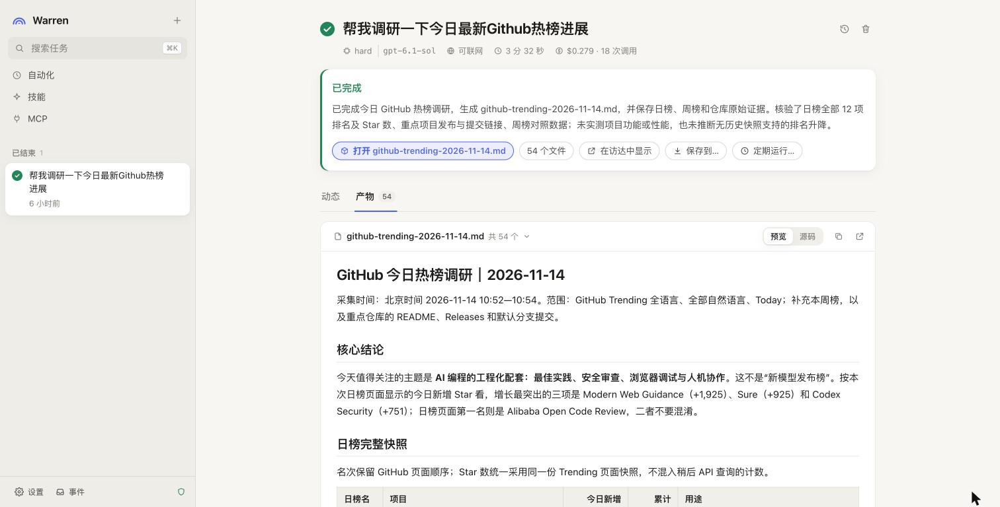
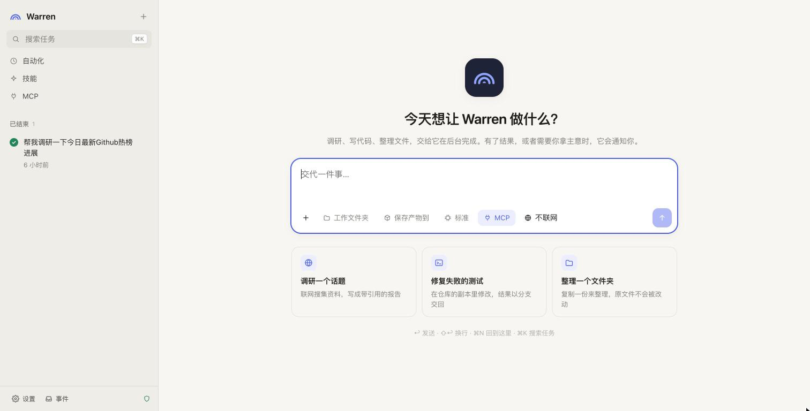
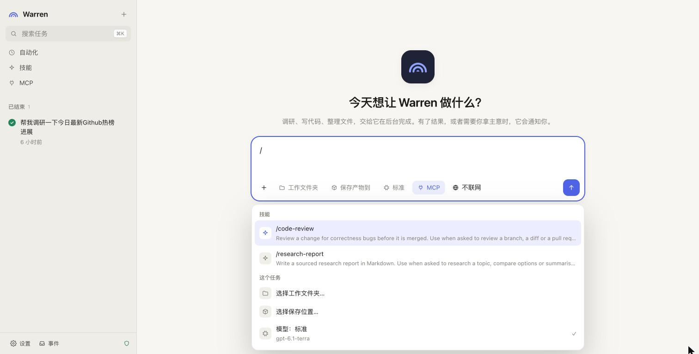
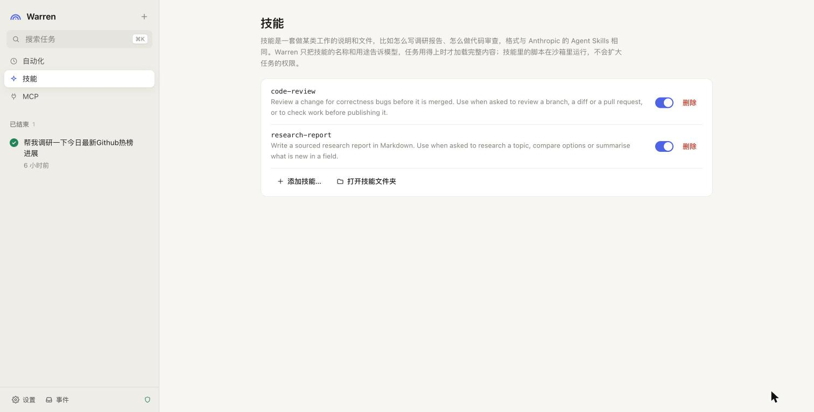
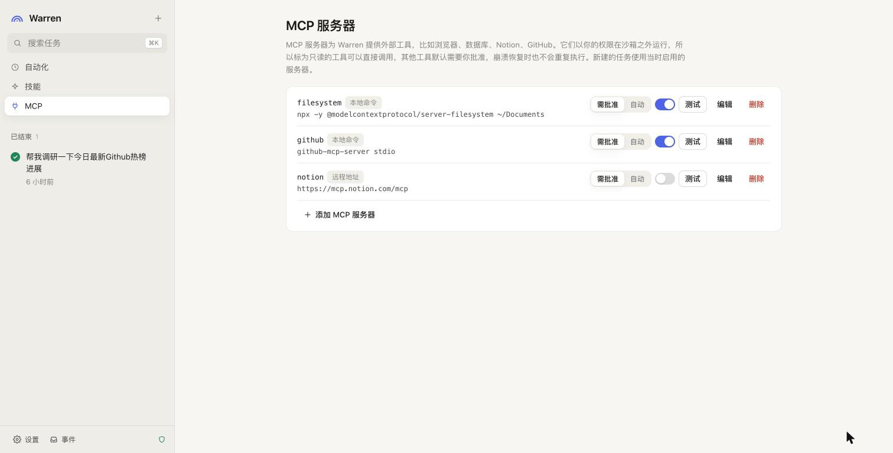

<p align="center">
  
</p>

<h1 align="center">Warren</h1>

<p align="center">
  An agent that runs continuously on your own Mac. Tasks you hand it run in the background,<br>
  for hours if needed, and continue where they stopped after a crash or a sleep.
</p>

<p align="center">
  <a href="https://github.com/Nguxw/Warren/actions/workflows/ci.yml"></a>
  <a href="https://github.com/Nguxw/Warren/releases"></a>
  <a href="LICENSE"></a>
  
</p>

<p align="center"><a href="README.md">中文</a> · English</p>

Warren is a daemon with three front ends: a web interface, a desktop app and a command line. Each task gets its own workspace: a git repository is cloned, any other folder is copied, and the commands the model runs are confined by the macOS sandbox. Results come back as a branch, a pull request or files; your original directory is never changed.

The agent itself (the loop, crash recovery, context compaction, tools and sandbox) is implemented in this repository, without another agent framework. Models are called only through their providers' official SDKs.

## Tech stack

| Part | Technology |
|---|---|
| Language and runtime | TypeScript, [Bun](https://bun.sh) 1.4 (runs, tests, bundles, and compiles a single executable) |
| Storage | SQLite (`bun:sqlite`, WAL, `synchronous = FULL`), one append-only event log per task |
| Daemon | [Hono](https://hono.dev) (HTTP + SSE, listening on 127.0.0.1 only), kept running by launchd |
| Models | OpenAI SDK (Responses API and Chat Completions-compatible endpoints), Anthropic SDK |
| Extensions | [MCP](https://modelcontextprotocol.io) TypeScript SDK (stdio, Streamable HTTP), skills in the Agent Skills format |
| Sandbox | macOS Seatbelt (`sandbox-exec`) |
| Interface | React 19, TanStack Query, react-markdown, bundled by Bun's HTML import; Chinese and English |
| Desktop app | [Tauri](https://tauri.app) 2 |
| Validation | zod: events, the API and the configuration share one set of definitions |
| Engineering | Bun workspaces, tsc, Biome, `bun:test`, GitHub Actions, Ed25519-signed releases |

<p align="center">
  
</p>

## What it does

- Research: gathers sources on the web and writes a report with citations, previewed in the interface.
- Code: edits, tests and commits in a clone of your repository, then pushes the commits back as a `warren/<id>` branch or opens a draft pull request.
- Files: sorts, converts or summarises the contents of a folder and saves the result where you choose.
- Schedules: for example, summarise GitHub trending every weekday at 18:30. A run missed while the computer slept is made up once.
- GitHub: mention @warren in an issue; its questions and conclusions are posted back to the issue.
- Skills and MCP: skills describe how to do a kind of work; MCP servers give it outside tools. Read-only MCP tools are called directly; others need your approval by default.

Models can be mixed: OpenAI, Anthropic and any OpenAI-compatible endpoint (DeepSeek, Qwen, Ollama, vLLM…), configured for three roles: standard, deep and fast.

<table>
  <tr>
    <td></td>
    <td></td>
  </tr>
  <tr>
    <td align="center">Start page: say what to do, press Enter</td>
    <td align="center">Type <code>/</code> for skills, model and network</td>
  </tr>
  <tr>
    <td></td>
    <td></td>
  </tr>
  <tr>
    <td align="center">Skills</td>
    <td align="center">MCP servers</td>
  </tr>
</table>

## Install

Requires macOS 13 or later, git, and an API key for a model (a local Ollama needs none).

```sh
curl -fsSL https://raw.githubusercontent.com/Nguxw/Warren/main/install.sh | sh

warren service install     # start the daemon at login (launchd); or run `warren daemon` in a terminal
warren open                # open the interface in your browser
```

The script downloads the build for your Mac (Apple Silicon or Intel) from [Releases](https://github.com/Nguxw/Warren/releases), checks its hash and puts it in `~/.local/bin`. Update later with `warren update` or under Settings → About; every update verifies the release signature first (see [012](docs/012-releases-and-updates.md), in Chinese).

Then add your key under **Settings → API keys** (bottom left), or write the key file yourself:

```sh
mkdir -p ~/.warren && chmod 700 ~/.warren
echo 'WARREN_OPENAI_API_KEY=sk-...' >> ~/.warren/credentials.env
chmod 600 ~/.warren/credentials.env
```

`warren doctor` checks the configuration, keys and sandbox.

**Desktop app:** download `Warren-darwin-arm64.app.zip` from Releases, unzip it and drag it to Applications. It is not notarized by Apple yet, so before the first launch run `xattr -dr com.apple.quarantine /Applications/Warren.app`, or right-click it in Finder and choose Open.

**From source,** with Bun 1.4+ (and a Rust toolchain for the desktop app):

```sh
git clone https://github.com/Nguxw/Warren.git && cd Warren
bun install
bun run build                        # dist/warren, interface included
cp dist/warren ~/.local/bin/
cd apps/desktop && bun run build     # optional: the desktop app
```

## Using it

### Interface

On the start page, say what to do and press Enter. Under the text you can choose a working folder, where to save results, the model, network access and which MCP servers the task may use; anything left alone uses the default. Type `/` or press + to use a skill.

On a task page, the status card says where the task is and whether it needs an answer or an approval from you. Activity is the full timeline, which can be replayed to any step; Changes shows a repository task's diff; Files previews what the task wrote.

The sidebar has pages for automations, skills and MCP. Settings (bottom left) holds language, appearance, models, API keys, defaults, approvals and updates.

Shortcuts: `/` skills and actions, `⌘N` new task, `⌘K` search, `⌘,` settings, `↩` send, `⇧↩` new line.

### Command line

```sh
warren run "Summarise this week's Bun releases"                  # start a task and follow it
warren run --repo ~/code/app "Fix the failing date tests, commit and publish the branch"
warren run --network --repo ~/Documents/notes --output ~/Desktop "Turn these notes into one summary"
warren tasks [--all]            # tasks in progress (or all)
warren follow <id>              # follow a task
warren answer <id> "<answer>"   # answer a task's question
warren approve <id>             # approve a waiting action; warren deny <id> "<reason>" refuses it
warren save <id> [<dir>]        # save a task's files
warren delete <id> --yes        # delete a task and its workspace
warren automations [run <id>]   # list automations, or run one now
warren stats                    # success rate, cost, time, interruptions, cache hit rate
warren update [--check]         # check for and install a new version
```

`<id>` can be the 8-character short id from the list.

A repository task works on a clone in `~/.warren/tasks/<id>/workspace` and pushes its commits back to your repository as `warren/<short id>`; your other branches are untouched. With `WARREN_GITHUB_TOKEN` set it can open a draft pull request, which needs your approval by default. A fine-grained token limited to the target repository is recommended.

## Configuration

Most settings can be changed in the interface and take effect immediately. They are stored in `~/.warren/config.json` (`WARREN_HOME` moves the directory):

```json
{
  "models": {
    "main": { "model": "gpt-6.1-terra", "reasoningEffort": "medium" },
    "hard": { "provider": "anthropic", "model": "claude-opus-5-5" },
    "cheap": {
      "provider": "openai-compatible",
      "baseUrl": "https://api.deepseek.com/v1",
      "model": "deepseek-chat",
      "apiKeySecret": "WARREN_DEEPSEEK_API_KEY"
    }
  },
  "concurrency": 3,
  "tasks": { "network": false },
  "approvals": { "publish_branch": "auto", "open_pull_request": "required" }
}
```

`main` (standard) is the default role; `hard` (deep) is for harder tasks; `cheap` (fast) is for simple tasks and for compacting the context of long ones.

Keys are read only from the environment and `~/.warren/credentials.env` (mode 0600), and all are named `WARREN_…`. They never reach the event log, the database or a task's processes. Warren does not read or write the configuration or login of Claude Code, Codex or `gh`.

## How it works

An agent that runs for a long time on a personal computer has four problems to solve, and Warren's main design decisions follow from them:

| Problem | Approach |
|---|---|
| A task outlives the process: it crashes, sleeps, restarts | A task's state is written to an event log in SQLite; the process keeps none of its own. Each step folds the log into the current state, acts, and appends events. Recovery is reading the log again |
| Recovery could repeat an outside action | `tool.started` reaches the disk before a tool runs. After a crash, reads and workspace edits run again; outside actions such as a push or a pull request are marked "outcome unknown", and the model checks the remote before deciding |
| A task outlasts the model's context window | What the model sees is a view of the log. When it fills up, the `cheap` model compacts older parts, never separating a tool call from its result |
| It runs on your real machine, unwatched | What a task may touch (workspace, network, privileged tools, budget) is fixed in its Grant when it is created. Seatbelt lets commands write only to the workspace and hides `~/.ssh`, the keychain and Warren's keys. Actions that need credentials, such as pushing, are carried out by the daemon in fixed ways and can require approval |

```
apps        web (interface) · desktop (Tauri) · cli
                       │  HTTP + SSE (127.0.0.1, token)
daemon      API · scheduler · automations · connectors · store (SQLite, sole writer)
core        state fold · agent loop · context compaction · routing · schedules   (pure, no IO)
adapters    model/  tools/ + sandbox  connectors/  mcp/
protocol    event format · conversation items · Grant · API contract            (shared)
```

Dependencies point one way: `protocol` ← `core` ← adapters ← `apps/*`. `core` does no IO, so the loop and recovery are tested step by step with a fake model and a fake clock.

The security boundary and its known limits (reads are restricted by a deny list; there is no sandbox on Linux) are in [005](docs/005-security.md). Report vulnerabilities privately as described in [SECURITY.md](SECURITY.md).

## Evaluation

| Evaluation | Result |
|---|---|
| [SWE-bench Verified](docs/009-swebench.md), 28 random instances, official harness | 23 resolved (82%); median $0.16 and 2.1 minutes per instance (`gpt-6.1-terra`) |
| [Chaos test](docs/004-testing.md): `kill -9` the running daemon at random moments | 200 tasks, 519 kills, 0 invariant violations |
| [Crash simulation](docs/004-testing.md): crash after every persisted step (exhaustive, plus 500 random runs) | every outside action ran exactly once |

## Development

```sh
bun install
bun run check                                  # typecheck + lint + all tests, as in CI
bun test <path>                                # some tests
WARREN_LIVE=1 bun test packages/model          # also the tests against the real APIs
bun run chaos 200                              # chaos test
WARREN_HOME=/tmp/warren-dev bun apps/cli/src/main.ts daemon   # a separate instance from source
```

A separate instance needs its own `server.port` in its `config.json`.

| Directory | Contents |
|---|---|
| `packages/protocol` | Event format, conversation items, Grant, automations, API contract |
| `packages/core` | State fold, agent loop, context compaction, routing, schedules, test doubles |
| `packages/model` | Model adapters: OpenAI Responses, OpenAI-compatible, Anthropic |
| `packages/tools` | Built-in tools, Seatbelt sandbox, privileged tools, skills |
| `packages/mcp` | MCP client |
| `packages/connectors` | GitHub connector: webhooks, reconcile polling, replies |
| `apps/daemon` | The daemon: store, scheduler, workspaces, automations, updates, HTTP API |
| `apps/web`, `apps/desktop`, `apps/cli` | Web interface, desktop shell, the `warren` command |
| `evals` | Chaos test, SWE-bench subset |

Before contributing, read [CONTRIBUTING.md](CONTRIBUTING.md) (in Chinese): it lists the rules whose violation would damage existing users' data or security.

## Documentation

The design documents in [`docs/`](docs) are in Chinese and meant to be read in order, starting with [000 Philosophy](docs/000-philosophy.md). The [index](docs/README.md) lists what each covers.

## License

[MIT](LICENSE)
