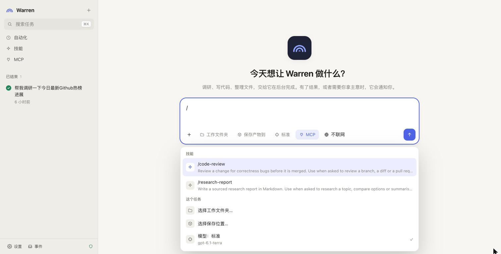

<p align="center">
  
</p>

<h1 align="center">Warren</h1>

<p align="center">
  在你自己的 Mac 上常驻运行的 Agent。任务交给它后在后台执行，<br>
  可以持续几小时；进程崩溃或电脑休眠后，从中断的地方继续。
</p>

<p align="center">
  <a href="https://github.com/Nguxw/Warren/actions/workflows/ci.yml"></a>
  <a href="https://github.com/Nguxw/Warren/releases"></a>
  <a href="LICENSE"></a>
  
</p>

<p align="center">中文 · <a href="README.en.md">English</a></p>

Warren 由一个守护进程和三个前端（Web 界面、桌面应用、命令行）组成。每个任务有自己的工作区：git 仓库会被克隆，普通文件夹会被复制，模型执行的命令运行在 macOS 沙箱里。结果以分支、Pull Request 或文件的形式交回，你的原目录不会被改动。

Agent 的执行部分（循环、崩溃恢复、上下文压缩、工具和沙箱）都在本仓库里实现，没有依赖其他 Agent 框架。调用模型只用各家官方的 SDK。

## 技术栈

| 部分 | 技术 |
|---|---|
| 语言与运行时 | TypeScript，[Bun](https://bun.sh) 1.4（运行、测试、打包，并编译成单文件程序） |
| 存储 | SQLite（`bun:sqlite`，WAL，`synchronous = FULL`），每个任务一份只追加的事件日志 |
| 守护进程 | [Hono](https://hono.dev)（HTTP + SSE，只监听 127.0.0.1），launchd 常驻 |
| 模型 | OpenAI SDK（Responses API 和兼容 Chat Completions 的接口）、Anthropic SDK |
| 扩展 | [MCP](https://modelcontextprotocol.io) TypeScript SDK（stdio、Streamable HTTP），Agent Skills 格式的技能 |
| 沙箱 | macOS Seatbelt（`sandbox-exec`） |
| 界面 | React 19、TanStack Query、react-markdown，由 Bun 的 HTML import 打包，中英双语 |
| 桌面应用 | [Tauri](https://tauri.app) 2 |
| 数据校验 | zod：事件、API 和配置共用同一套定义 |
| 工程 | Bun workspaces，tsc 类型检查，Biome，`bun:test`，GitHub Actions，Ed25519 签名的发行版 |

<p align="center">
  
</p>

## 能做什么

- 调研：联网搜集资料，写成带引用的报告，在界面里直接预览。
- 改代码：在仓库的克隆里修改、运行测试、提交，把提交作为 `warren/<id>` 分支推回你的仓库，或者开一个草稿 PR。
- 处理文件：整理、转换、汇总一个文件夹里的内容，完成后保存到你指定的位置。
- 定时运行：比如每个工作日 18:30 汇总 GitHub 热榜。电脑休眠时错过的运行，醒来后补跑一次。
- 接收 GitHub 上的工作：在 issue 里 @warren，它的提问和结论会回复到 issue。
- 用技能和 MCP 扩展：技能告诉它某类工作怎么做；MCP 服务器给它外部工具。只读的 MCP 工具直接调用，其他工具默认需要你批准。

模型可以混用：OpenAI、Anthropic，以及任何 OpenAI 兼容接口（DeepSeek、Qwen、Ollama、vLLM 等）。按"标准、深度、快速"三个角色分别配置。

<table>
  <tr>
    <td></td>
    <td></td>
  </tr>
  <tr>
    <td align="center">起始页：写下要做的事，回车开始</td>
    <td align="center">输入 <code>/</code> 选用技能、切换模型和联网</td>
  </tr>
  <tr>
    <td></td>
    <td></td>
  </tr>
  <tr>
    <td align="center">技能</td>
    <td align="center">MCP 服务器</td>
  </tr>
</table>

## 安装

需要 macOS 13 或更高版本、git，以及一个模型的 API key（本地的 Ollama 不需要）。

```sh
curl -fsSL https://raw.githubusercontent.com/Nguxw/Warren/main/install.sh | sh

warren service install     # 登录时自动启动守护进程（launchd）；也可以在终端里运行 warren daemon
warren open                # 在浏览器里打开界面
```

安装脚本从 [Releases](https://github.com/Nguxw/Warren/releases) 下载适合这台 Mac（Apple Silicon 或 Intel）的程序，校验哈希后放进 `~/.local/bin`。以后用 `warren update` 或设置页的"关于"更新。每次更新都会先验证发布签名，见 [012](docs/012-releases-and-updates.md)。

打开界面后，在左下角 **设置 → API 密钥** 里填入 key。也可以直接写入密钥文件：

```sh
mkdir -p ~/.warren && chmod 700 ~/.warren
echo 'WARREN_OPENAI_API_KEY=sk-...' >> ~/.warren/credentials.env
chmod 600 ~/.warren/credentials.env
```

`warren doctor` 会检查配置、密钥和沙箱。

**桌面应用：** 从 Releases 下载 `Warren-darwin-arm64.app.zip`，解压后拖进"应用程序"。应用还没有经过 Apple 公证，第一次打开前需要执行 `xattr -dr com.apple.quarantine /Applications/Warren.app`，或者在访达里右键选"打开"。

**从源码构建：** 需要 Bun 1.4+；构建桌面应用还需要 Rust 工具链。

```sh
git clone https://github.com/Nguxw/Warren.git && cd Warren
bun install
bun run build                        # 编译出 dist/warren，界面已打包在里面
cp dist/warren ~/.local/bin/
cd apps/desktop && bun run build     # 可选：桌面应用
```

## 使用

### 界面

在起始页写下要做的事，按回车。输入框下方可以选择工作文件夹、产物保存位置、模型、是否联网，以及这个任务能用的 MCP 服务器；不选就用默认值。输入 `/` 或点 "+" 可以选用技能。

任务页上方的状态卡说明任务现在的状态，以及是否需要你回答问题或批准动作。下面有三个标签页："动态"是完整的时间线，可以回放到任意一步；"改动"显示仓库任务的 diff；"产物"预览任务写出的文件。

侧栏有自动化、技能和 MCP 三个页面。左下角的设置里有语言、外观、模型、API 密钥、默认选项、审批规则和版本更新。

快捷键：`/` 技能和操作，`⌘N` 新任务，`⌘K` 搜索，`⌘,` 设置，`↩` 发送，`⇧↩` 换行。

### 命令行

```sh
warren run "调研本周 Bun 的更新，写成摘要"                     # 新建任务并跟随输出
warren run --repo ~/code/app "修复失败的日期测试，提交并发布分支"
warren run --network --repo ~/Documents/资料 --output ~/Desktop "整理成一份摘要"
warren tasks [--all]             # 进行中的任务（--all 包括已结束的）
warren follow <id>               # 跟随一个任务
warren answer <id> "<回答>"      # 回答任务的问题
warren approve <id>              # 批准等待中的动作；warren deny <id> "<原因>" 拒绝
warren save <id> [<目录>]        # 把产物保存到目录
warren delete <id> --yes         # 删除任务及其工作区
warren automations [run <id>]    # 列出自动化，或立即运行一个
warren stats                     # 成功率、费用、用时、打扰次数、缓存命中率
warren update [--check]          # 检查并安装新版本
```

`<id>` 可以用列表里显示的 8 位短 id。

仓库任务在 `~/.warren/tasks/<id>/workspace` 的克隆上工作，完成后把提交推回你的仓库，分支名是 `warren/<短 id>`，其他分支不受影响。配置 `WARREN_GITHUB_TOKEN` 后它可以开草稿 PR，默认需要你批准。建议用只授权目标仓库的 fine-grained token。

## 配置

大部分设置可以在界面里修改，立即生效。设置保存在 `~/.warren/config.json`，用 `WARREN_HOME` 可以换目录：

```json
{
  "models": {
    "main": { "model": "gpt-6.1-terra", "reasoningEffort": "medium" },
    "hard": { "provider": "anthropic", "model": "claude-opus-5-5" },
    "cheap": {
      "provider": "openai-compatible",
      "baseUrl": "https://api.deepseek.com/v1",
      "model": "deepseek-chat",
      "apiKeySecret": "WARREN_DEEPSEEK_API_KEY"
    }
  },
  "concurrency": 3,
  "tasks": { "network": false },
  "approvals": { "publish_branch": "auto", "open_pull_request": "required" }
}
```

`main`（标准）是默认角色；`hard`（深度）用于更难的任务；`cheap`（快速）用于简单任务和长任务的上下文压缩。

密钥只从环境变量和 `~/.warren/credentials.env`（权限 0600）读取，名字都以 `WARREN_` 开头。密钥不会写进事件日志、数据库，也不会传给任务的子进程。Warren 不读写 Claude Code、Codex 或 `gh` 的配置和登录状态。GitHub 连接器的配置见 [007](docs/007-connectors.md)。

## 工作原理

一个在个人电脑上长时间运行的 Agent 要面对四个问题，Warren 的主要设计都由此而来：

| 问题 | 做法 |
|---|---|
| 任务比进程活得久，中途会崩溃、休眠、重启 | 每个任务的状态都写在 SQLite 的事件日志里，进程本身不保存状态。每一步先从日志折叠出当前状态，执行后再追加事件。恢复就是重新读日志 |
| 恢复时可能重复执行对外动作 | 工具开始执行前，`tool.started` 事件先写进磁盘。崩溃后，读文件、改工作区这类动作直接重跑；推送、开 PR 这类对外动作标为"结果未知"，由模型先核对远端状态再决定 |
| 任务比模型的上下文窗口长 | 发给模型的上下文是日志的一个视图。快满时用 `cheap` 模型压缩早期内容，工具调用和它的结果不会被拆开 |
| 在你的真实机器上运行，没人盯着 | 任务能访问什么（工作区、网络、特权工具、预算）在创建时写进 Grant，之后不能更改。Seatbelt 沙箱只允许写工作区，读不到 `~/.ssh`、钥匙串和 Warren 的密钥。推送、开 PR 这类需要凭证的动作由守护进程按固定方式代为执行，可以要求审批 |

```
apps        web（界面）· desktop（Tauri）· cli
                       │  HTTP + SSE（127.0.0.1，带 token）
daemon      API · 调度器 · 自动化 · 连接器 · Store（SQLite，唯一写入者）
core        状态折叠 · Agent 循环 · 上下文压缩 · 路由 · 时间表      （纯逻辑，无 IO）
adapters    model/  tools/ + 沙箱  connectors/  mcp/
protocol    事件格式 · 对话格式 · Grant · API 契约                  （所有包共享）
```

依赖只朝一个方向：`protocol` ← `core` ← 适配器 ← `apps/*`。`core` 不做 IO，所以循环和恢复逻辑可以在测试里用假模型、假时钟逐步验证。

安全边界和已知局限（例如读取限制是黑名单、Linux 上没有沙箱）见 [005](docs/005-security.md)。发现安全问题请按 [SECURITY.md](SECURITY.md) 私下报告。

## 评测

| 评测 | 结果 |
|---|---|
| [SWE-bench Verified](docs/009-swebench.md)：随机抽取 28 个实例，用官方 harness 打分 | 解决 23 个（82%）；每个实例的中位数为 $0.16、2.1 分钟（`gpt-6.1-terra`） |
| [混沌测试](docs/004-testing.md)：在随机时刻 `kill -9` 正在运行的守护进程 | 200 个任务、519 次强杀，不变量违反 0 次 |
| [崩溃模拟](docs/004-testing.md)：在每个持久化步骤之后崩溃（穷举，加 500 组随机） | 对外动作都恰好执行一次 |

## 开发

```sh
bun install
bun run check                                  # 类型检查 + lint + 全部测试，和 CI 相同
bun test <路径>                                 # 只跑部分测试
WARREN_LIVE=1 bun test packages/model          # 加上调用真实 API 的测试
bun run chaos 200                              # 混沌测试
WARREN_HOME=/tmp/warren-dev bun apps/cli/src/main.ts daemon   # 从源码运行一个独立实例
```

独立实例需要在它的 `config.json` 里换一个 `server.port`。

| 目录 | 内容 |
|---|---|
| `packages/protocol` | 事件格式、对话格式、Grant、自动化、API 契约 |
| `packages/core` | 状态折叠、Agent 循环、上下文压缩、路由、时间表，以及测试替身 |
| `packages/model` | 模型适配器：OpenAI Responses、OpenAI 兼容、Anthropic |
| `packages/tools` | 内置工具、Seatbelt 沙箱、特权工具、技能 |
| `packages/mcp` | MCP 客户端 |
| `packages/connectors` | GitHub 连接器：webhook、补漏轮询、回复 |
| `apps/daemon` | 守护进程：存储、调度、工作区、自动化、更新、HTTP API |
| `apps/web`、`apps/desktop`、`apps/cli` | Web 界面、桌面外壳、`warren` 命令 |
| `evals` | 混沌测试、SWE-bench 子集 |

提交前请阅读 [CONTRIBUTING.md](CONTRIBUTING.md)，其中列出了几条一旦违反就会影响已有用户数据或安全的规则。

## 文档

[`docs/`](docs) 里是中文设计文档，按编号阅读，从 [000 理念](docs/000-philosophy.md) 开始。每篇的主题见 [文档目录](docs/README.md)。

## 许可

[MIT](LICENSE)
