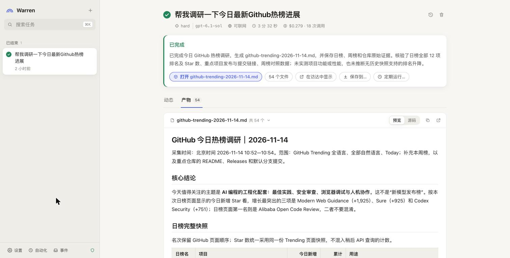
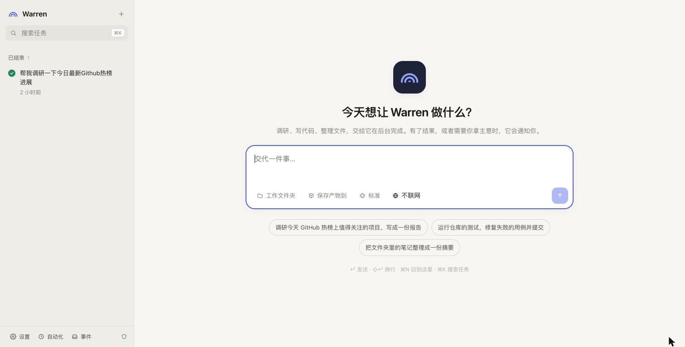
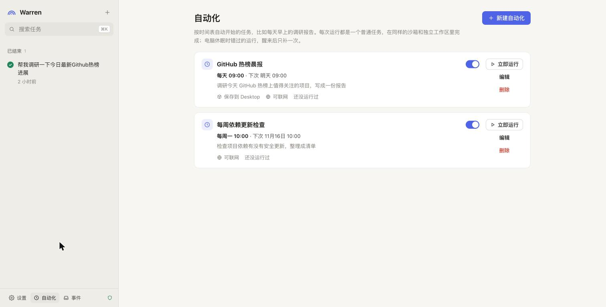

<p align="center">
  
</p>

<h1 align="center">Warren</h1>

<p align="center">
  在你自己电脑上常驻的长程 Agent：把调研、写代码、整理文件交给它，<br>
  它在后台的独立工作区里做完，只在有结果或需要你拿主意时找你。
</p>

<p align="center">
  <a href="https://github.com/Nguxw/Warren/actions/workflows/ci.yml"></a>
  <a href="LICENSE"></a>
  
  
</p>

<p align="center">
  
</p>

## 为什么是 Warren

大多数编码 Agent 的用法是"你看着它干活"：开一个终端会话，盯着它一步步改你的目录。Warren 换了一个角度：**它替你干活，你去忙别的。**

- 交代一件事就可以走开。任务在后台跑几分钟到几小时，电脑休眠、进程崩溃、重启都不会丢进度。
- 它不碰你的原目录：仓库会克隆一份，普通文件夹会复制一份，结果以分支、PR 或"保存到…"交回，由你决定要不要。
- 它只在三种时候找你：有问题要问、有动作要批准、结果可以用了。

## 特性

- **常驻与可恢复：** 每个任务是一份只追加的事件日志（SQLite）。任务状态由日志折叠而来，崩溃后从日志接着执行；对外动作（推送、开 PR）被打断后不会盲目重做。在 200 个任务、519 次 `kill -9` 的混沌测试中，外部动作无一重复执行。
- **沙箱：** 模型执行的命令跑在 macOS Seatbelt 沙箱里：只能写自己的工作区，读不到 `~/.ssh`、钥匙串和 Warren 自己的密钥，网络按任务开关。需要凭证的动作由守护进程按固定方式代为执行，并可要求你审批。
- **多模型：** 内部使用与提供方无关的对话格式，内置 OpenAI（Responses）、OpenAI 兼容接口（DeepSeek、Qwen、Ollama、vLLM 等）和 Anthropic 三个适配器。按角色（标准、深度、快速）配置模型，长任务自动压缩上下文。
- **产物：** 调研报告、数据文件在界面里直接预览（Markdown、表格、图片），一键在访达中打开，或保存到你指定的文件夹。
- **自动化：** 按时间表自动开始的任务，比如"每天 9:00 调研 GitHub 热榜，报告保存到桌面"。休眠时错过的运行，醒来后只补一次。
- **GitHub：** 在 issue 里 @warren 派活，提问和结论回复到 issue；CI 失败这类推断出来的工作先"观察"，确认判断可靠再自动开工。
- **界面：** 中英双语的 Web 界面和 macOS 桌面应用（Tauri），实时时间线、轨迹回放、系统通知，以及功能完整的命令行。
- **只用自己的凭证：** 数据都在 `~/.warren/`，使用你单独配置的 API key，从不读写 Claude Code、Codex 或 `gh` 的配置和登录态。

<table>
  <tr>
    <td></td>
    <td></td>
  </tr>
  <tr>
    <td align="center">交代一件事，回车就开始</td>
    <td align="center">按时间表自动运行的任务</td>
  </tr>
</table>

## 快速开始

**环境：** macOS 13 或更高、[Bun](https://bun.sh) 1.4+、git。还需要一个模型的 API key（OpenAI、Anthropic 或任意 OpenAI 兼容接口；本地的 Ollama 不需要 key）。

```sh
git clone https://github.com/Nguxw/Warren.git
cd Warren
bun install
bun run build                       # 编译出单文件程序 dist/warren（包含界面）
cp dist/warren /usr/local/bin/      # 或者 PATH 中的任意目录

warren service install              # 登录时自动启动守护进程（launchd）；也可以在终端里运行 warren daemon
warren open                         # 在浏览器里打开界面
```

打开界面后，在左下角的 **设置 → API 密钥** 里填入 key，就可以在起始页交代第一件事了。也可以直接写入密钥文件：

```sh
mkdir -p ~/.warren && chmod 700 ~/.warren
echo 'WARREN_OPENAI_API_KEY=sk-...' >> ~/.warren/credentials.env
chmod 600 ~/.warren/credentials.env
```

**桌面应用（可选）：** 需要 Rust 工具链（`brew install rustup && rustup default stable`）。

```sh
cd apps/desktop && bun run build
open src-tauri/target/release/bundle/macos/Warren.app
```

`warren doctor` 会检查配置、密钥和沙箱是否就绪。

## 使用

### 界面

- **起始页：** 写下要做的事，回车开始。输入框下方可以选择工作文件夹（git 仓库会克隆，其他文件夹会复制）、保存产物的位置、模型档位和是否联网；不选就用默认值。
- **任务页：**
  - 状态卡显示现在怎样、需要你做什么；
  - "动态"是完整的时间线，可以回放到任意一步；
  - "改动"显示仓库任务的 diff；
  - "产物"预览任务写出的文件。
- **自动化：** 在侧栏左下角。在已完成的任务上点"定期运行…"，可以把它变成自动化。
- **设置：** 语言、外观、模型、API 密钥、是否默认联网、并发数、哪些动作需要审批。

快捷键：`⌘N` 新任务 · `⌘K` 搜索 · `⌘,` 设置 · `↩` 发送 · `⇧↩` 换行。

### 命令行

```sh
warren run "调研本周 Bun 的更新，写成摘要"                     # 新建任务并跟随输出
warren run --repo ~/code/app "修复失败的日期测试，提交并发布分支"
warren run --network --repo ~/Documents/资料 --output ~/Desktop "整理成一份摘要"
warren tasks                     # 进行中的任务（--all 包括已结束的）
warren follow <id>               # 跟随一个任务
warren answer <id> "<回答>"      # 回答任务的问题
warren approve <id>              # 批准等待中的动作（如开 PR）；warren deny <id> "<原因>" 拒绝
warren save <id> [<目录>]        # 把产物保存到目录
warren delete <id> --yes         # 删除任务及其工作区
warren automations [run <id>]    # 列出自动化，或立即运行一个
warren triggers                  # GitHub 事件及 Warren 的决定
warren stats                     # 成功率、费用、用时、打扰次数、缓存命中率
```

`<id>` 可以用列表里显示的 8 位短 id。

### 仓库任务的结果

任务在 `~/.warren/tasks/<id>/workspace` 里的独立克隆上工作，完成后把提交发布回你的仓库，作为 `warren/<短 id>` 分支，你的其他分支不会被改动。配置 `WARREN_GITHUB_TOKEN` 后，它还可以开草稿 PR（默认需要你批准）。建议使用只授权目标仓库的 fine-grained token。

## 配置

大部分设置可以在界面的设置页里修改，并立即生效。它们保存在 `~/.warren/config.json`（设置 `WARREN_HOME` 可以换目录）：

```json
{
  "models": {
    "main": { "model": "gpt-6.1-terra", "reasoningEffort": "medium" },
    "hard": { "provider": "anthropic", "model": "claude-opus-5-5" },
    "cheap": {
      "provider": "openai-compatible",
      "baseUrl": "https://api.deepseek.com/v1",
      "model": "deepseek-chat",
      "apiKeySecret": "WARREN_DEEPSEEK_API_KEY"
    }
  },
  "concurrency": 3,
  "tasks": { "network": false },
  "approvals": { "publish_branch": "auto", "open_pull_request": "required" }
}
```

| 角色 | 界面名称 | 用途 |
|---|---|---|
| `main` | 标准 | 默认 |
| `hard` | 深度 | 更难的任务 |
| `cheap` | 快速 | 简单任务，以及长任务的上下文压缩 |

密钥只从环境变量和 `~/.warren/credentials.env`（权限 0600）读取，名字都以 `WARREN_` 开头，不与其他工具共用 `OPENAI_API_KEY` 这类变量。密钥不会写入事件日志、数据库或任务的子进程。GitHub 连接器的配置见 [007](docs/007-connectors.md)。

## 工作原理

```
apps        web（界面）· desktop（Tauri 外壳）· cli
                       │  HTTP + SSE（127.0.0.1，带 token）
daemon      API · 调度器 · 自动化 · 连接器接入 · Store（SQLite，唯一写入者）
core        状态折叠 · Agent 循环 · 上下文压缩 · 路由 · 时间表        （纯逻辑，无 IO）
adapters    model/（OpenAI · 兼容接口 · Anthropic）  tools/ + 沙箱  connectors/（GitHub）
protocol    事件格式 · 对话格式 · Grant · API 契约                    （所有包共享）
```

- **日志是唯一事实来源。** 每一步都是"读状态、执行、追加事件"。`tool.started` 在工具执行前落盘（`synchronous = FULL`），所以崩溃后能分辨哪些动作可能已经发生：读写类工具重跑，对外动作标记为"结果未知"，交给模型先核对再决定。
- **边界靠机制，不靠提示词。** 任务能碰什么（工作区、网络、特权工具、预算）在创建时写进 Grant，之后不可变；沙箱和特权工具保证模型越不过去。
- **依赖方向单一：** `protocol` ← `core` ← 适配器 ← `apps/*`，只有守护进程负责组装。

| 目录 | 内容 |
|---|---|
| `packages/protocol` | 事件格式、内部对话格式、Grant、自动化、API 契约（zod） |
| `packages/core` | 状态折叠、Agent 循环、上下文压缩、路由、时间表；接口定义和测试替身 |
| `packages/model` | 模型适配器：OpenAI Responses、OpenAI 兼容、Anthropic |
| `packages/tools` | 内置工具、Seatbelt 沙箱、特权工具（发布分支、开 PR） |
| `packages/connectors` | GitHub：webhook、补漏轮询、回复 |
| `apps/daemon` | 守护进程：Store、调度器、工作区、产物、自动化、HTTP API |
| `apps/web` | Web 界面（React，由 Bun 打包，中英双语） |
| `apps/desktop` | 桌面外壳（Tauri v2）：原生窗口和菜单栏图标 |
| `apps/cli` | `warren` 命令和 launchd 服务 |
| `evals` | 混沌测试、SWE-bench 子集评测 |

## 安全

Warren 假设模型读到的任何内容都可能是提示词注入，所以边界全部由机制保证：

- **沙箱：** 写入只限工作区，凭证目录不可读，网络按任务开关；
- **特权工具由守护进程代为执行：** 从不在工作区里运行 git，分支名固定且只能快进；
- **密钥只写不读；**
- **API 只接受本机的 Host 头。**

已知局限（例如读取是黑名单、Linux 上没有沙箱）写在 [005 安全边界](docs/005-security.md)。发现安全问题请按 [SECURITY.md](SECURITY.md) 报告。

## 评测

| 评测 | 结果 |
|---|---|
| [SWE-bench Verified](docs/009-swebench.md) 随机 28 个实例，官方 harness 打分 | 解决 23 个（82%）；每个实例中位数 $0.16、2.1 分钟（`gpt-6.1-terra`） |
| [混沌测试](docs/004-testing.md)：在随机时刻 `kill -9` 真实的守护进程 | 200 个任务、519 次强杀，不变量违反 0 次 |
| [崩溃模拟](docs/004-testing.md)：在每个持久化步骤之后崩溃（穷举加 500 组随机） | 外部动作恰好执行一次 |

## 开发

```sh
bun install
bun run check                               # 类型检查 + lint + 全部测试（和 CI 一致）
bun test <路径>                              # 只跑部分测试
WARREN_LIVE=1 bun test packages/model       # 加上真实 API 测试（花费不到一美分）
bun run chaos 200                           # 混沌测试
bun run format                              # 自动格式化
WARREN_HOME=/tmp/warren-dev bun apps/cli/src/main.ts daemon   # 从源码运行一个独立的开发实例
```

开发实例要在它的 `config.json` 里换一个 `server.port`，避免和正在用的实例冲突。贡献前请阅读 [CONTRIBUTING.md](CONTRIBUTING.md)，里面列出了几条改动代价很高、必须遵守的规则，例如事件格式只升版本、不修改，`tool.started` 必须先于执行落盘。

## 文档

设计文档按编号阅读，每篇只依赖前面的内容：

| 文档 | 内容 |
|---|---|
| [000 理念](docs/000-philosophy.md) | 本地长程 Agent 的约束、原则和核心概念 |
| [001 事件日志](docs/001-event-log.md) | 事件格式、不变量、版本演进、存储 |
| [002 循环与恢复](docs/002-loop-and-recovery.md) | 由状态推出下一步；崩溃、休眠后的恢复 |
| [003 运行时](docs/003-runtime.md) | 守护进程、调度、工作区、模型适配器、工具、API |
| [004 测试与验证](docs/004-testing.md) | 崩溃模拟、混沌测试、适配器契约测试 |
| [005 安全边界](docs/005-security.md) | 威胁模型、沙箱、特权工具与审批 |
| [006 界面与常驻](docs/006-interface.md) | Web 界面、产物、设置、通知、launchd、桌面外壳 |
| [007 连接器：GitHub](docs/007-connectors.md) | webhook 与补漏轮询、路由规则、结果回到 issue |
| [008 上下文与指标](docs/008-context-and-metrics.md) | 长任务的上下文压缩、`warren stats` |
| [009 基准评测](docs/009-swebench.md) | SWE-bench Verified 子集的方法、结果与复现 |
| [010 自动化](docs/010-automations.md) | 按时间表开始的任务 |

## 路线图

- Linux 沙箱（bubblewrap），让 Linux 上的任务也运行在受限环境里
- 按域名的网络白名单，替代"全开或全关"
- 更多工作来源：邮件、日历、Slack 等连接器
- 通过 MCP 接入外部工具
- 签名的安装包和自动更新

## 许可

[MIT](LICENSE)
